# Trace screenshots

Captured from the core dev app (`npm start`, then open `/trace`). Light on the left, dark on the right.

### Agent turn, mid-run (spinner + shimmer on the running step)

| Light | Dark |
| --- | --- |
| 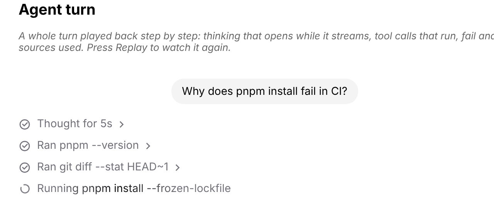 | 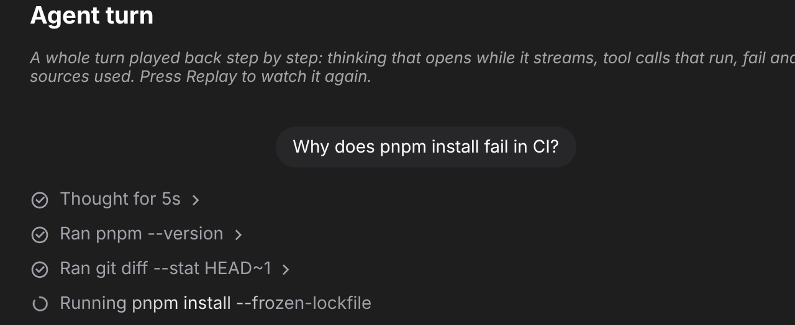 |

### Agent turn, finished

| Light | Dark |
| --- | --- |
| 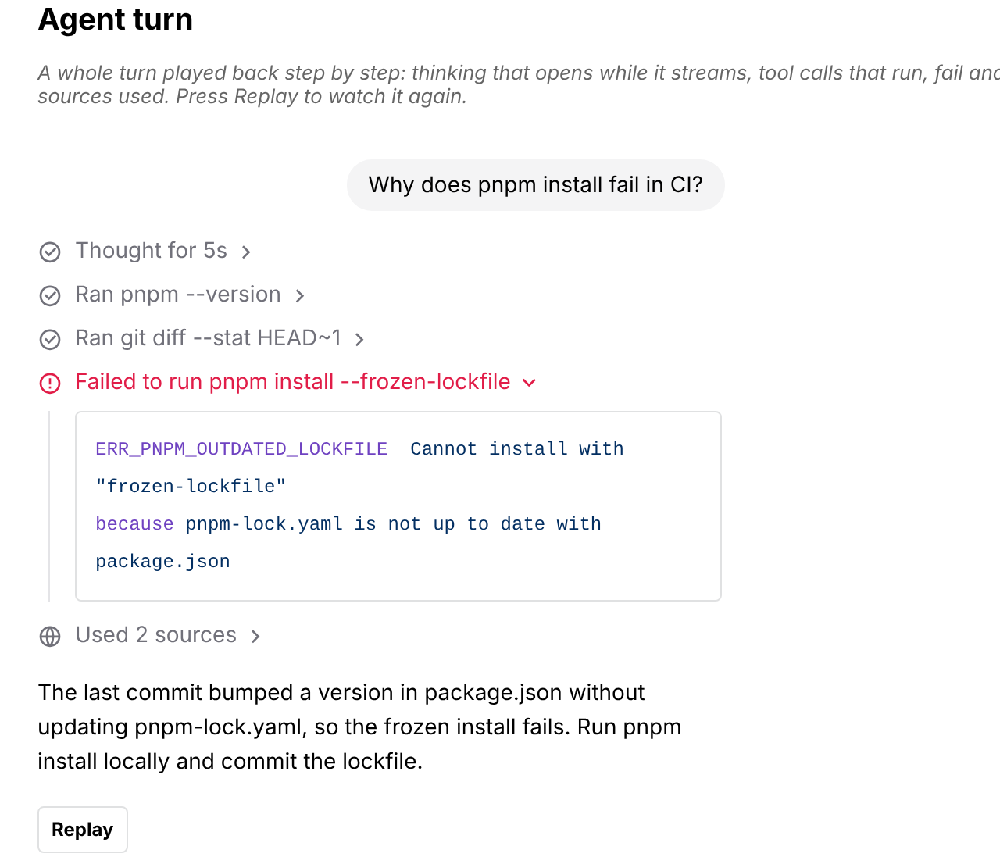 | 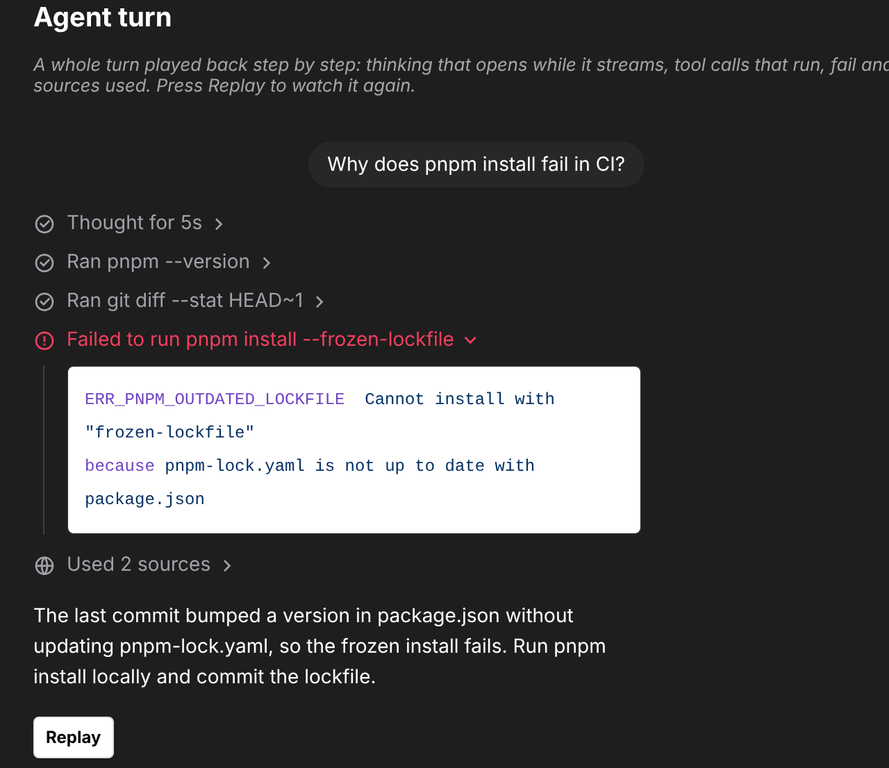 |

### Status

| Light | Dark |
| --- | --- |
| 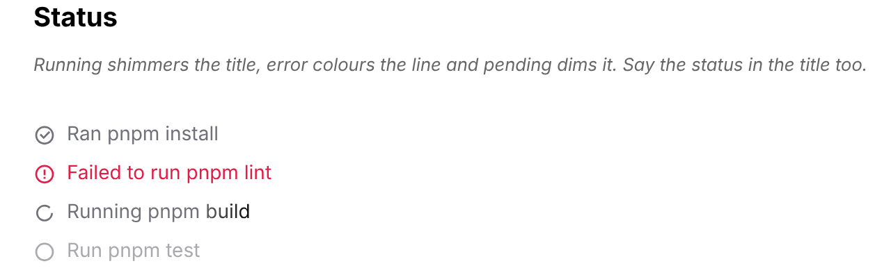 | 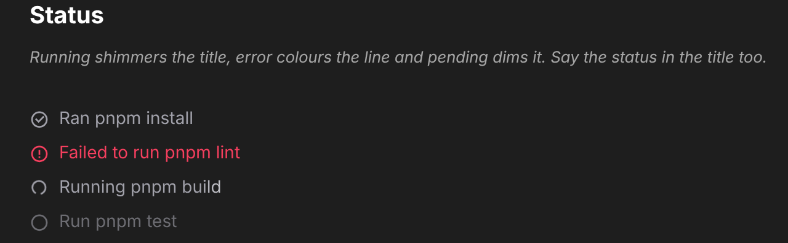 |

### Description

| Light | Dark |
| --- | --- |
| 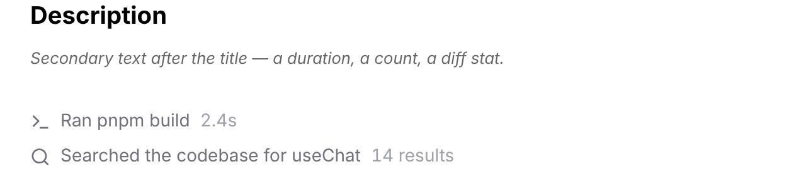 | 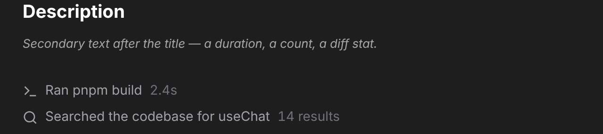 |

### Collapsible (content is the existing CodeBlock)

| Light | Dark |
| --- | --- |
| 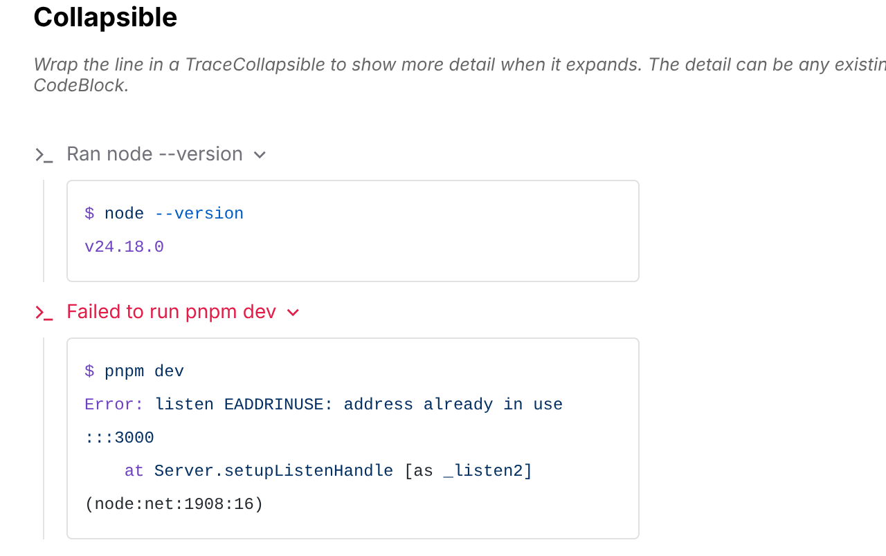 | 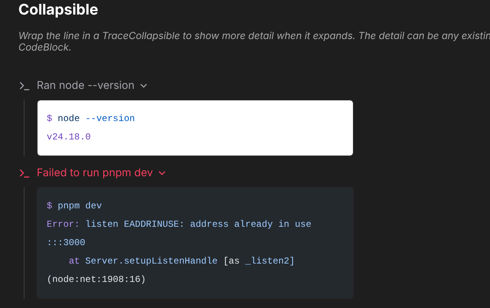 |

### Controlled open state

| Light | Dark |
| --- | --- |
| 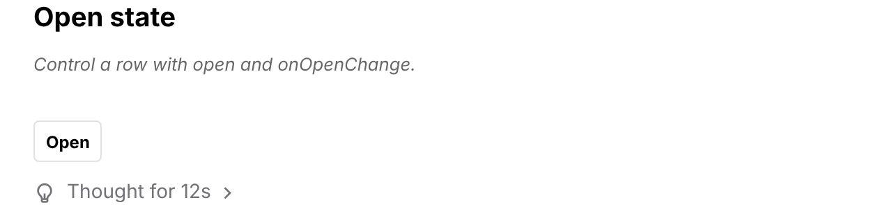 | 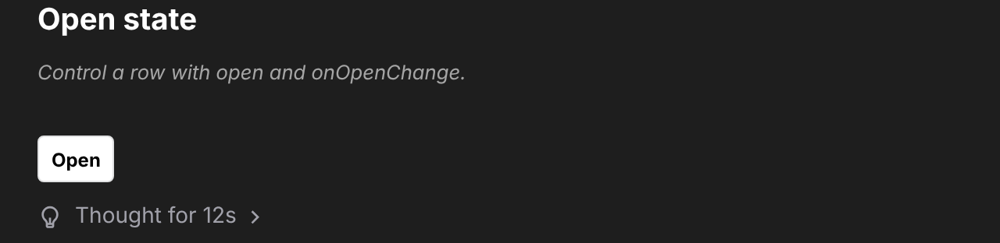 |

### Link rows

| Light | Dark |
| --- | --- |
| 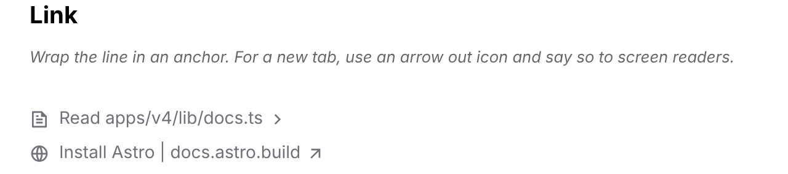 | 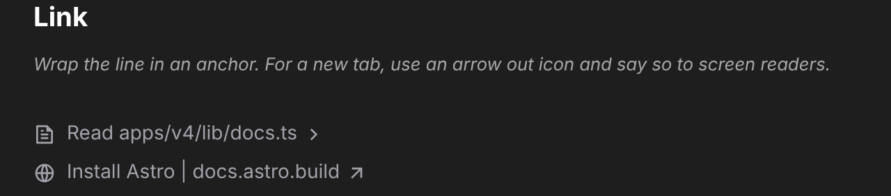 |

### Rows that open a Modal / Drawer

| Light | Dark |
| --- | --- |
| 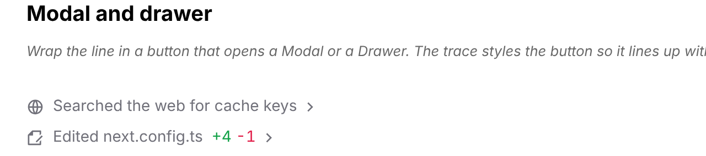 | 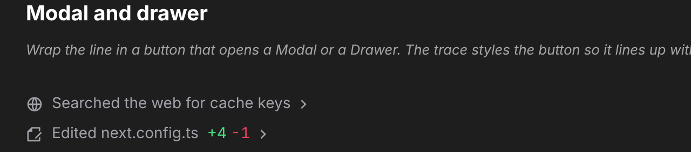 |

### The Modal opened from a trace row

| Light | Dark |
| --- | --- |
| 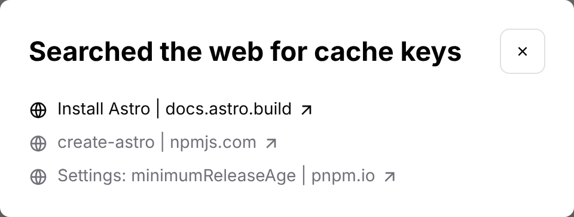 |  |

### Sources

| Light | Dark |
| --- | --- |
| 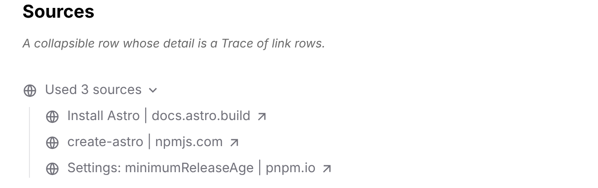 | 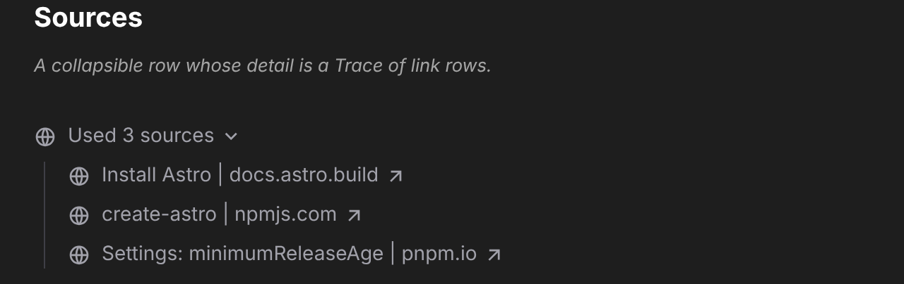 |

### Chain of thought (nested trace)

| Light | Dark |
| --- | --- |
| 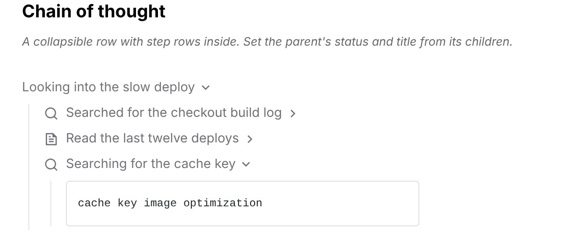 | 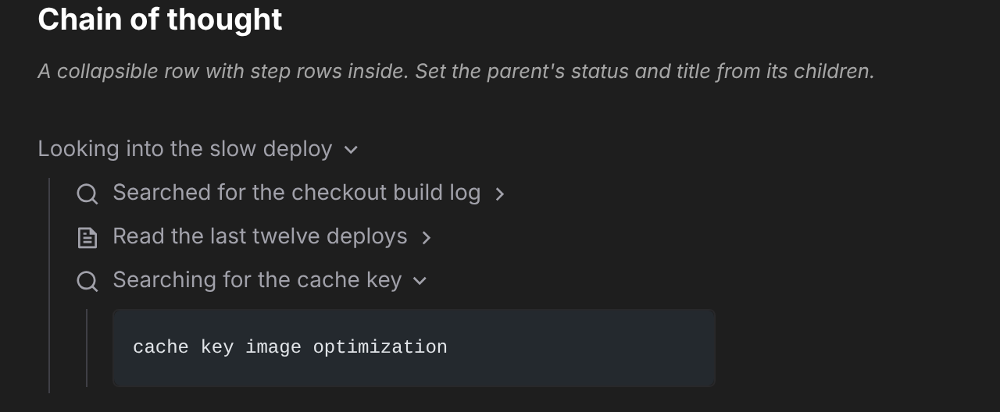 |

### Commit

| Light | Dark |
| --- | --- |
| 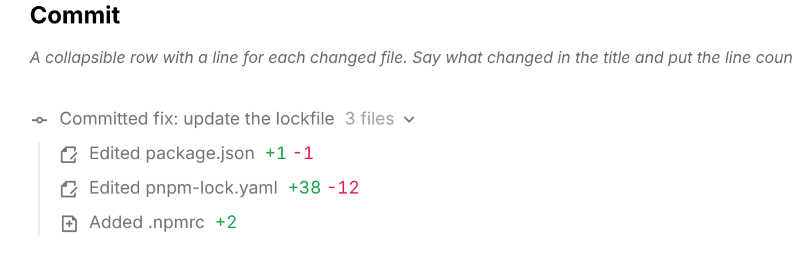 | 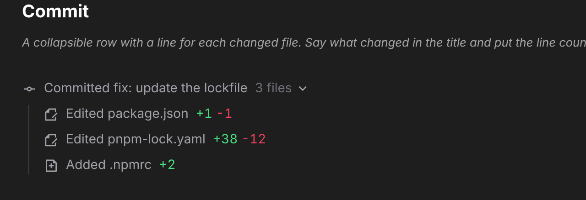 |
